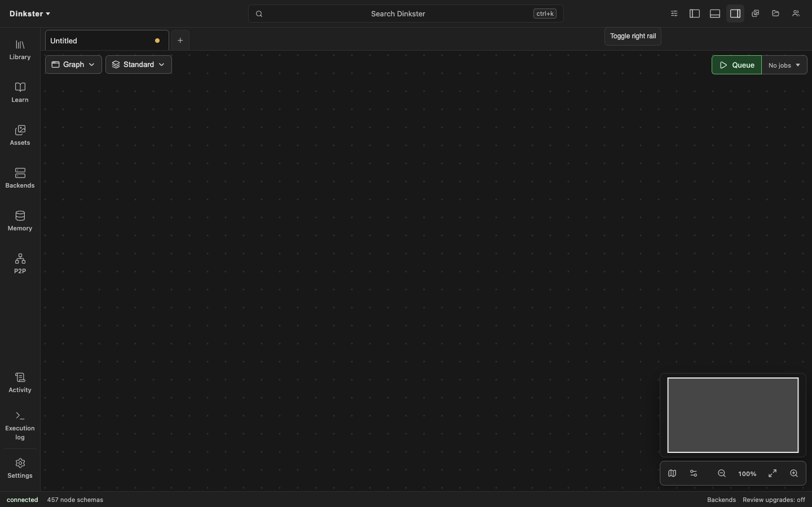

# Browser editor quickstart

The source run script starts the engine and browser frontend on one loopback
origin, prepares missing or stale pack catalogs, and opens the editor. These
source-checkout steps work on Windows x64, Linux x64, and Apple Silicon with
macOS 14 or newer. Intel macOS is unsupported.

## Install

Install [Node.js 26.12 or newer within 26.x](https://nodejs.org/), including npm, and
[Git](https://git-scm.com/downloads). Clone Dinkster, then run one command:

```sh
git clone https://github.com/Kosinkadink/Dinkster.git
cd Dinkster
./run.sh
```

On Windows, replace `./run.sh` with:

```powershell
.\run.ps1
```

If PowerShell blocks local scripts, use
`powershell -NoProfile -ExecutionPolicy Bypass -File .\run.ps1`.
If uv is missing, the script installs it using the
[official installer](https://docs.astral.sh/uv/getting-started/installation/)
in `~/.local/bin` (`%USERPROFILE%\.local\bin` on Windows), without sudo,
administrator rights, or shell-profile changes. Linux needs curl or wget
for this download. The installed uv is available immediately to the script.
The script builds the pinned frontend and prepares a contributor development
generation in the sibling `.<checkout-name>-development` project, then opens the
editor. Its Python, torch and tools are separate from the checkout's uv environment.
It does not need the Desktop app or a separate frontend checkout. Windows verifies
the runtime's [SQLite mapped-shm recovery](install.md#windows-interpreter).
The first run downloads dependencies and can take several minutes.
Linux and Windows default to CPU; Apple Silicon uses `mac-arm64` with MPS.
For another host-compatible variant, run `python scripts/develop.py setup
--variant NAME --yes` explicitly and start that project with the development
commands rather than rerunning the CPU-default launcher.

The scripts create the local library under `~/.dinkster`
(`%USERPROFILE%\.dinkster` on Windows). Set `DINKSTER_HOME` before launch to
choose another writable location. They preserve model mounts and output files.
They select a live contributor engine, not published setup or standalone
installed packs. The terminal and served node catalog label this mode as
unreviewed and not exactly restorable. Dependency changes require setup again;
engine source edits need only a stop/start. For explicit live pack/library inputs
and captured generations that can be restored, see
[development packs](install.md#development-packs-from-local-folders).

## Launch

```sh
./run.sh
```

Use `.\run.ps1` on Windows. After `git pull`, run the same command: environments
are refreshed and the frontend rebuilds when its pin changes. The private
`.run/frontend` directory is script-managed; do not edit it.

The editor opens at `http://127.0.0.1:3639`. Its application, API, and event
connections all use that origin. The launcher selects no packs, so an empty
editor with zero node schemas is healthy. To run nodes, select the required
pack folders through [development setup](install.md#development-packs-from-local-folders);
pack locations do not have to be inside the engine checkout. Published setup
still selects its registry defaults separately.
The process supervisor keeps the engine running after the launcher returns.

Use `python scripts/develop.py stop --yes` to stop the engine. If the default port is busy,
run `./run.sh --port 4640` (`.\run.ps1 --port 4640` on Windows).
Use `--no-browser` on a headless machine and
open the printed URL from a browser on that machine.

For a manual source launch without the script, see
[develop from source](install.md#develop-from-source). For managed published
generations, use the environment commands rather than the source launcher.

An embedded or headless core installation may omit both optional packages.
Use a separate environment for that installation. Contributor tools and the
source launcher use the active development generation, not the checkout's
root environment.

Installers that select capabilities explicitly can use the `dinkster[collab]`
and `dinkster[supervisor]` extras. The default `dinkster` install selects both.



## Generate a first image

The launcher does not download model weights. Download the SD 1.5 checkpoint
`v1-5-pruned-emaonly-fp16.safetensors` into a dedicated models folder, then add
that folder to `~/.dinkster/library/mounts.toml`:

```toml
[mounts.models]
path = "/absolute/path/to/models"
mode = "read"
priority = 0
```

On Windows, use a TOML path such as `C:/Users/name/Models`. Keep the existing
`[settings]` and `[mounts.output]` sections that the source launcher created. See
[installation](install.md#model-folders) for the full format.

The run scripts select the execution interpreter automatically, including
during pack-catalog preparation. No ComfyUI checkout or server is required.
CPU and Apple Silicon model sampling remains subject to the
[supported host boundaries](supported/cpu-and-apple-silicon-hosts.md).

Workflow templates are disabled by default. Build an SD 1.5 workflow
on the empty canvas:

1. Load the checkpoint with `Load Checkpoint`.
2. Enter positive and negative text in the two `CLIP Text Encode` nodes.
3. Connect `Empty Latent Image`, the model, and both conditioning outputs to
   `KSampler`.
4. Decode the sampled latent with `VAE Decode` and connect it to `Save Image`.
5. Select **Run** and wait for the image preview and saved output.

In `Load Checkpoint`, use **Browse** to select the mounted checkpoint. If no
models are available, check the `models` path in `mounts.toml` and restart
Dinkster so it can scan the folder.

This is the default SD 1.5 graph: checkpoint loader, two text encoders, empty
latent image, sampler, VAE decoder, and image saver. No ComfyUI checkout or
server is part of the native launch.
